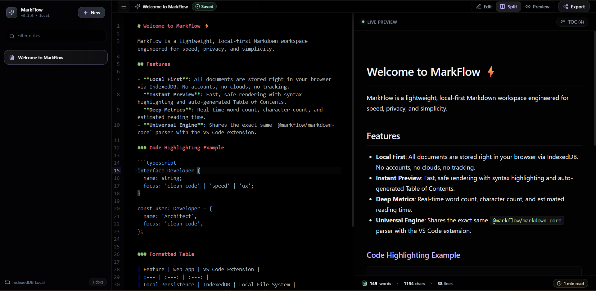
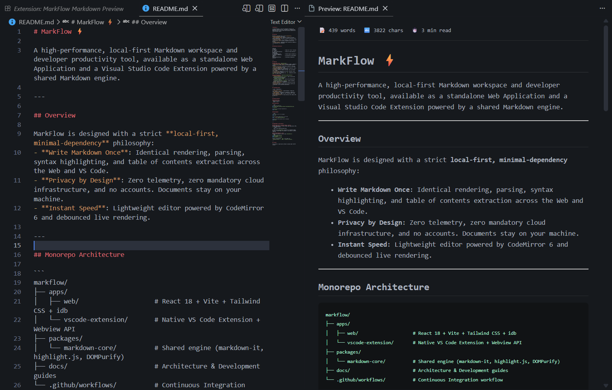

# MarkFlow ⚡

[](https://marketplace.visualstudio.com/items?itemName=abekdev.markflow-preview)
[](https://opensource.org/licenses/MIT)
[](#core-product-philosophy)
[](https://nodejs.org/)
[](https://marketplace.visualstudio.com/items?itemName=abekdev.markflow-preview)

A high-performance, local-first **Markdown workspace and developer productivity suite**, available as a standalone **Web Application** and an official **Visual Studio Code Extension**, both powered by a shared, universal Markdown processing engine.

---

## 📸 Product Showcase

### 1. Web Application (`@markflow/web`)
> Pure AMOLED Black liquid glass interface with live synchronized preview, CodeMirror 6 editor, Table of Contents drawer, and local IndexedDB persistence.



### 2. VS Code Extension (`markflow-preview`)
> Side-by-side native Markdown preview, real-time word/character count, reading time estimation, and syntax highlighting.



---

## 💡 Core Product Philosophy

- **Write Markdown Once**: Identical rendering, parsing, syntax highlighting, and Table of Contents extraction across the Web and VS Code.
- **Local-First & Private**: Zero telemetry, zero mandatory cloud accounts, and no third-party servers. Your documents remain strictly on your machine.
- **Fast Startup & Minimal Footprint**: Modular architecture with debounced preview updates ($150\text{ms}$) and minimal dependency footprint.

---

## 🏛️ Monorepo Architecture

```
markflow/
├── apps/
│   ├── web/                    # React 18 + Vite + CodeMirror 6 + Tailwind CSS + IndexedDB
│   └── vscode-extension/       # Native VS Code Extension (Webview API + CSP)
├── packages/
│   └── markdown-core/          # Shared engine (markdown-it, highlight.js, DOMPurify)
├── docs/                       # Architectural specs & development guides
└── docs/screenshots/          # High-resolution showcase assets
```

### The Shared Engine: `@markflow/markdown-core`
All parsing, AST traversal, syntax highlighting, slug generation, and metrics are encapsulated within `@markflow/markdown-core`. Fix a Markdown rendering rule once, and both the Web App and VS Code Extension immediately benefit.

---

## 🚀 Quick Start

### Prerequisites
- Node.js >= 18.0.0
- npm >= 9.0.0

### Installation & Development

```bash
# 1. Clone the repository
git clone https://github.com/abhi-v017/markflow.git
cd markflow

# 2. Install dependencies across all workspaces
npm install

# 3. Start the Web Workspace in dev mode
npm run dev
```
Open [http://localhost:3000](http://localhost:3000) in your browser.

### Build All Workspaces

```bash
# Build the shared engine and all packages
npm run build
```

---

## 📦 Deployment & Marketplace

### Web Application (Vercel)
The web application is pre-configured with [vercel.json](vercel.json) for instant deployment:
```bash
npx vercel --prod
```

### VS Code Extension (Marketplace & VSIX)
Build and package the extension locally:
```bash
cd apps/vscode-extension
npm run build
npx @vscode/vsce package --no-dependencies -o abekdev.markflow-preview-0.1.1.vsix
```
Install directly into VS Code:
```text
VS Code -> Extensions (Ctrl+Shift+X) -> "..." Menu -> "Install from VSIX..."
```
Or install from the [Visual Studio Marketplace](https://marketplace.visualstudio.com/items?itemName=abekdev.markflow-preview).

---

## 📄 License

Open-source software licensed under the [MIT License](LICENSE).
