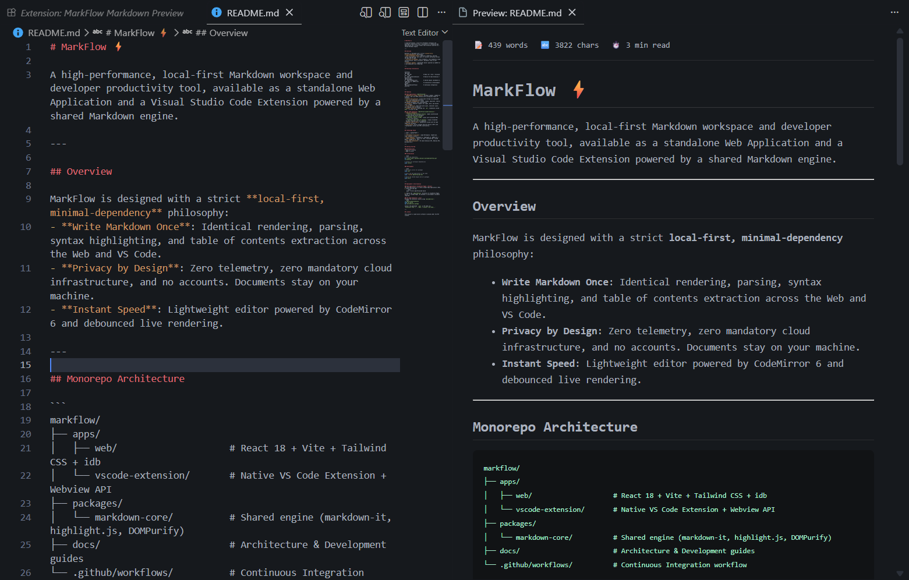
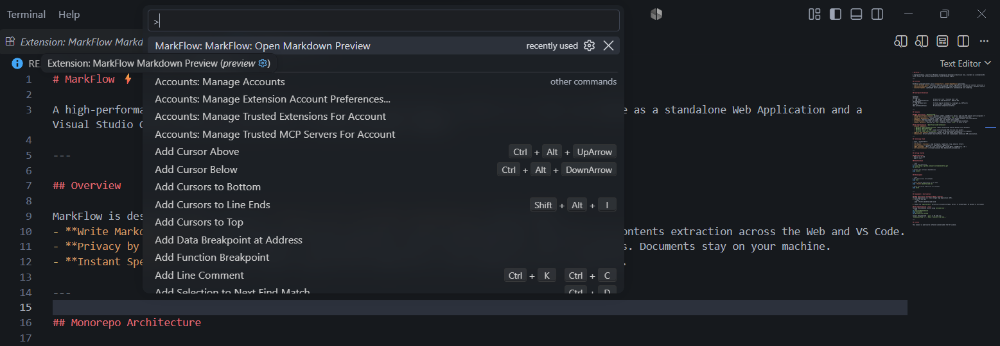

# MarkFlow — Modern Markdown Workspace & Live Preview ⚡

A lightweight, distraction-free **Markdown preview and developer productivity tool** for Visual Studio Code. MarkFlow provides an instant side-by-side live preview, live reading metrics, syntax highlighting, 1-click Table of Contents generation, and standalone HTML export.

---

## 📸 Live Preview Showcase

> **Side-by-side synchronized rendering**: Type in your Markdown editor on the left, and watch MarkFlow render formatted typography, syntax-highlighted code blocks, and real-time document metrics on the right.

---

## ⚡ Quick Start (How to Use in 3 Seconds)

You don't need any complex configuration. MarkFlow works out of the box:

1. Open any **`.md`** (Markdown) file in VS Code.
2. Open the preview using either method:
   - **Click the Top-Right Icon:** Click the MarkFlow preview icon in your editor tab toolbar.
   - **Command Palette:** Press `Ctrl + Shift + P` (or `Cmd + Shift + P` on macOS), type **`MarkFlow: Open Markdown Preview`**, and press **Enter**.

3. Start typing! The preview updates smoothly beside your code in real time.

---

## ✨ Key Features

### 🔄 Real-Time Synchronized Preview
Enjoy a high-performance preview with debounced rendering ($150\text{ms}$) that never lags your editor, even on large technical documentation files.

### 📊 Live Document Metrics
Keep track of your document size at a glance directly in the preview header:
- 📝 **Word count**
- 🔤 **Character count**
- ⏱️ **Estimated reading time** (calculated dynamically at standard 200 WPM)

### 🎨 Native VS Code Theme Integration
MarkFlow doesn't force a generic browser style. It dynamically maps to your active VS Code theme variables (`--vscode-editor-foreground`, `--vscode-editor-background`, `--vscode-editor-font-family`), ensuring high contrast and visual harmony across Dark, Light, AMOLED, and High-Contrast themes.

### 📋 1-Click Table of Contents
Writing a long README or technical documentation? Run **`MarkFlow: Copy Table of Contents`**. MarkFlow extracts all heading levels (`#`, `##`, `###`), creates slugified markdown links, and copies the formatted list directly to your clipboard. Just press `Ctrl + V` to paste!

### 📄 Export to Standalone HTML
Export your rendered Markdown as a clean, self-contained `.html` document with embedded responsive styling and print-to-PDF rules using **`MarkFlow: Export as HTML`**.

### 💻 Code Syntax Highlighting
Fenced code blocks are styled with syntax highlighting across all major programming languages: TypeScript, JavaScript, Python, HTML, CSS, Rust, Go, SQL, Bash, JSON, and YAML.

---

## ⌨️ Command Palette Reference

All features are easily accessible via the Command Palette (`Ctrl + Shift + P` / `Cmd + Shift + P`):

| Command | Action |
| :--- | :--- |
| **`MarkFlow: Open Markdown Preview`** | Opens the live synchronized preview beside your active editor. |
| **`MarkFlow: Copy Table of Contents`** | Scans headings and copies a formatted Markdown TOC list to your clipboard. |
| **`MarkFlow: Export as HTML`** | Opens a native save dialog and exports a standalone styled HTML file. |
| **`MarkFlow: Refresh Preview`** | Manually refreshes the preview state. |

---

## 🛡️ Security & Privacy First

- **Zero Telemetry**: MarkFlow collects zero usage data, zero analytics, and zero tracking tokens.
- **100% Local-First**: Your documents never leave your machine and are never sent to external servers or AI services.
- **Strict Content Security Policy (CSP)**: Built with cryptographic nonces preventing arbitrary script injection (XSS protection) within the VS Code webview sandbox.

---

## 🌐 Web Workspace Companion

MarkFlow is also available as a standalone, local-first web application powered by browser IndexedDB.

- **GitHub Repository:** [github.com/abhi-v017/markflow](https://github.com/abhi-v017/markflow)
- **Issues & Feedback:** [github.com/abhi-v017/markflow/issues](https://github.com/abhi-v017/markflow/issues)

---

## 📄 License

Open-source software licensed under the [MIT License](https://opensource.org/licenses/MIT).
