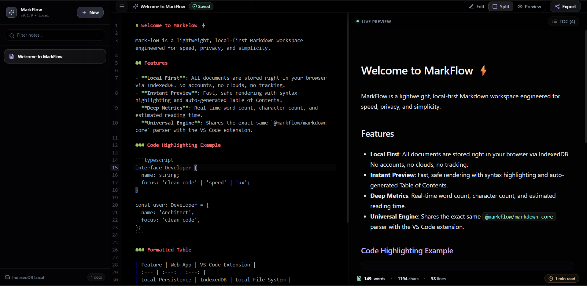
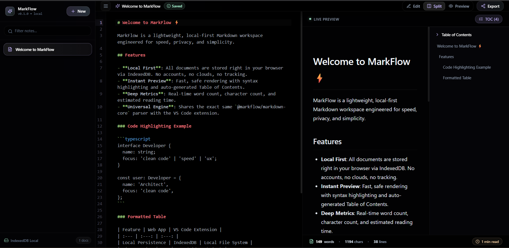
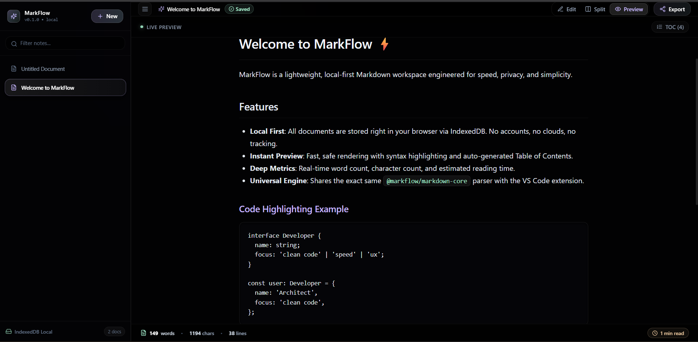
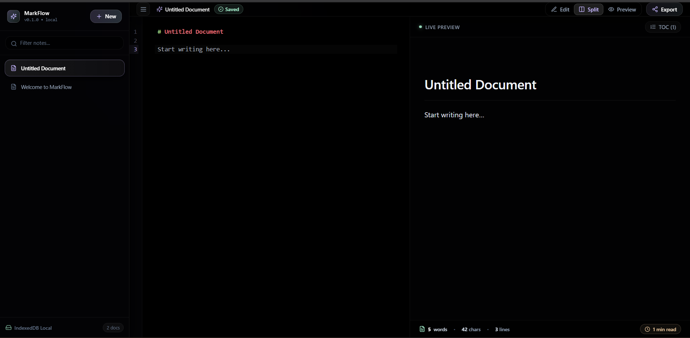

# MarkFlow Web — Local-First Markdown Workspace ⚡

[](https://react.dev/)
[](https://vitejs.dev/)
[](https://tailwindcss.com/)
[](#-local-first-storage)
[](https://opensource.org/licenses/MIT)

A lightweight, distraction-free **Markdown workspace** engineered for speed, privacy, and simplicity. Features a clean AMOLED Black liquid glass design with soft pastel accents, CodeMirror 6 editor, real-time preview, Table of Contents drawer, live writing metrics, and local-first persistence via IndexedDB.

---

## 📸 Workspace Showcase

### 1. Split-View Workspace (Editor + Live Preview)

> Three-panel responsive layout: Document management sidebar on the left, CodeMirror 6 editor in the center, and live synchronized preview with real-time word/character counts on the right.

---

### 2. Collapsible Table of Contents Drawer

> Real-time AST-based Table of Contents drawer that auto-detects heading hierarchies (`H1`–`H6`) and enables smooth one-click navigation throughout the document.

---

### 3. Focus Preview Mode

> Toggle to full preview mode for an uninterrupted reading and proofreading experience with styled code blocks, tables, and typography.

---

### 4. Local-First Document Management

> Create, search, rename, duplicate, and delete documents with instant debounced auto-saving to your browser's IndexedDB.

---

## ✨ Key Features

- **🔒 100% Local-First**: All documents are stored directly in your browser's IndexedDB. Zero cloud tracking, no mandatory accounts, no telemetry.
- **🖤 AMOLED Black Liquid Glass Design**: True pitch-black aesthetic (`#000000`) with frosted glass panels, soft pastel highlights (Lavender, Mint, Sky, Peach), and smooth micro-interactions.
- **⚡ CodeMirror 6 Editor**: Fast, modular editor with line numbering, code folding, bracket matching, and active line highlights.
- **📊 Real-Time Metrics**: Live header and status bar reporting word count, character count, line count, and reading time estimate.
- **📑 Floating Table of Contents**: Jump effortlessly between sections with one-click anchor navigation.
- **📦 Multi-Format Export**:
  - Download raw Markdown source (`.md`).
  - Export standalone styled HTML (`.html`) ready for browser viewing.
  - Native browser print-to-PDF layout with dedicated print media styles.
  - Copy sanitized HTML snippet to clipboard.

---

## 🛠️ Technology Stack

| Layer | Technologies |
| :--- | :--- |
| **Framework & Build** | React 18, Vite, TypeScript |
| **Editor Component** | CodeMirror 6 (`@codemirror/view`, `@codemirror/state`, `@codemirror/lang-markdown`) |
| **Styling** | Tailwind CSS, Custom Neumorphic Liquid Glass, Lucide React Icons |
| **Persistence** | Browser IndexedDB via `idb` |
| **Processing Engine** | `@markflow/markdown-core` (markdown-it, highlight.js, DOMPurify) |

---

## 🚀 Getting Started

### Prerequisites
- Node.js >= 18.0.0
- npm >= 9.0.0

### Run Locally

1. **Install dependencies from the repository root**:
   ```bash
   npm install
   ```

2. **Start the development server**:
   ```bash
   npm run dev
   ```

3. Open your browser at [http://localhost:3000](http://localhost:3000).

---

## 🚢 Deployment (Vercel)

The web application is pre-configured for instant zero-configuration deployment to Vercel via [vercel.json](../../vercel.json):

```bash
# Build the application
npm run build

# Deploy via Vercel CLI
npx vercel --prod
```

Or connect the repository on [vercel.com](https://vercel.com) for automatic continuous deployment on every `git push`.

---

## 📄 License

Open-source software licensed under the [MIT License](https://opensource.org/licenses/MIT).
